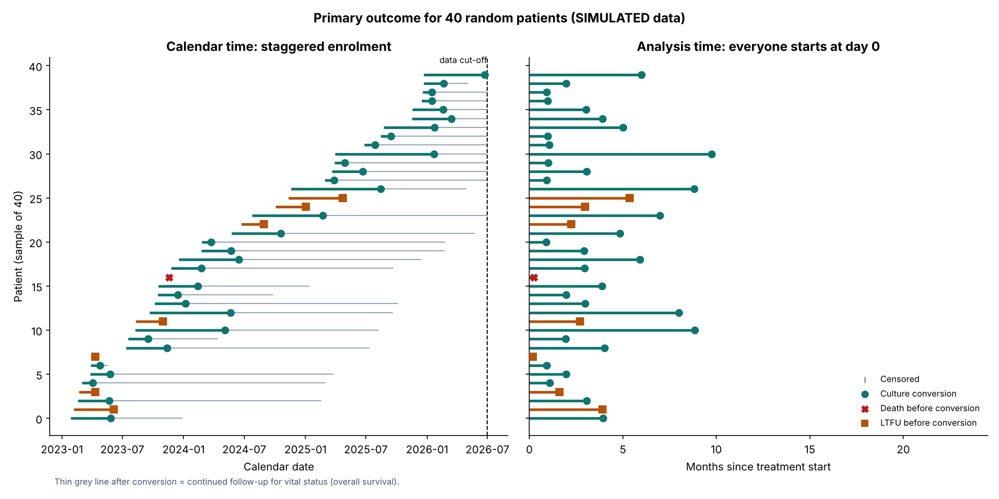
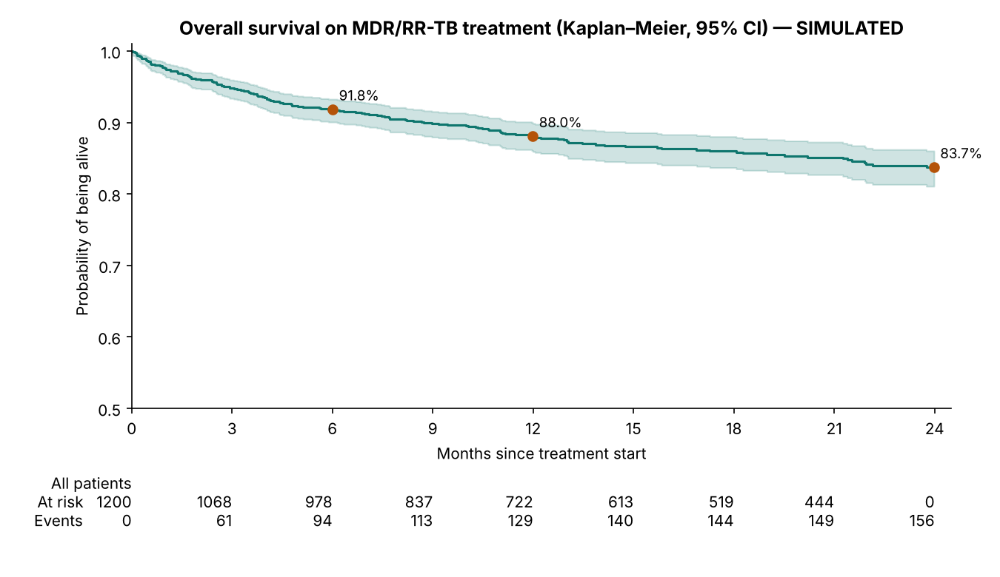
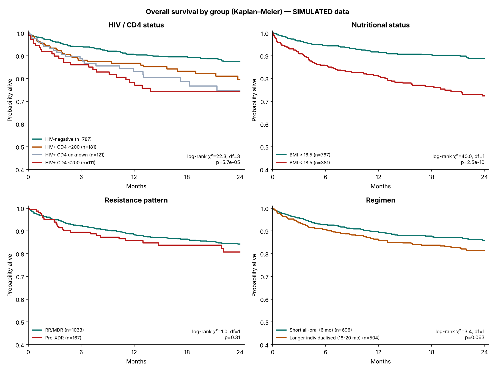
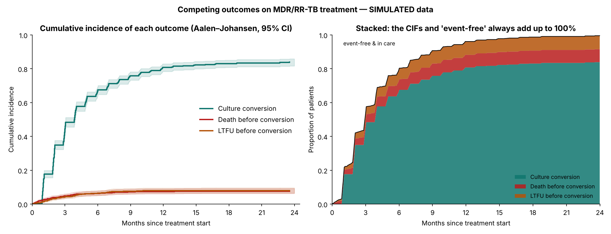
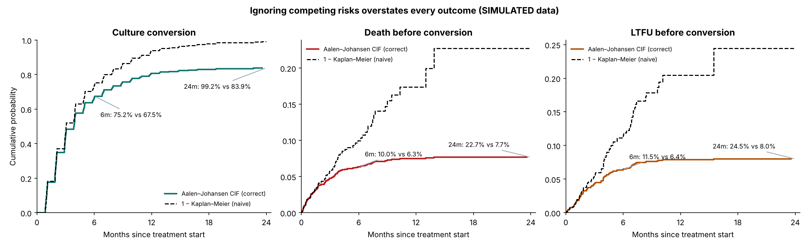
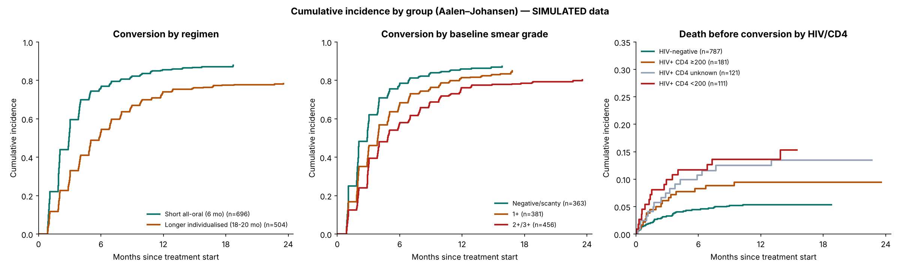
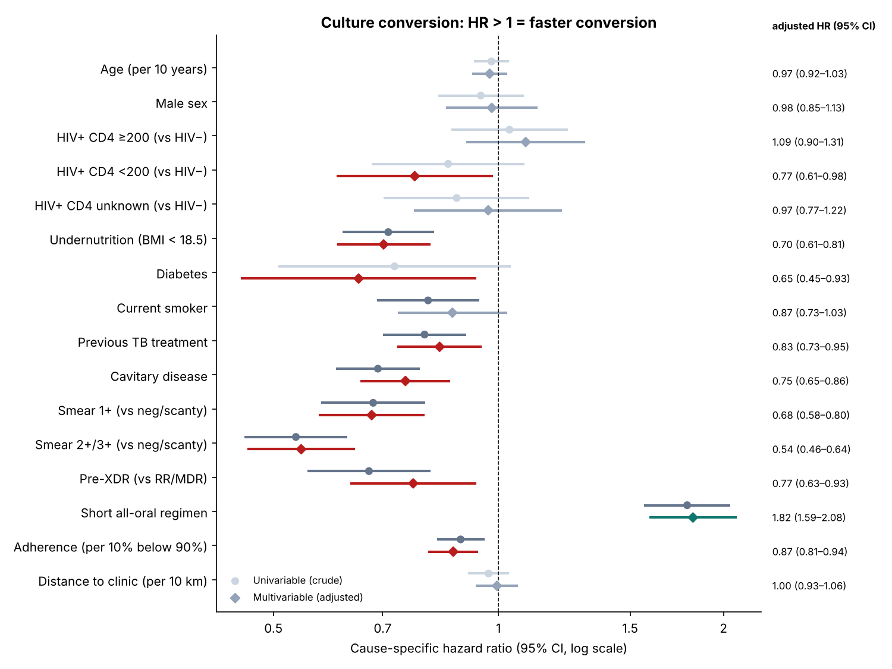
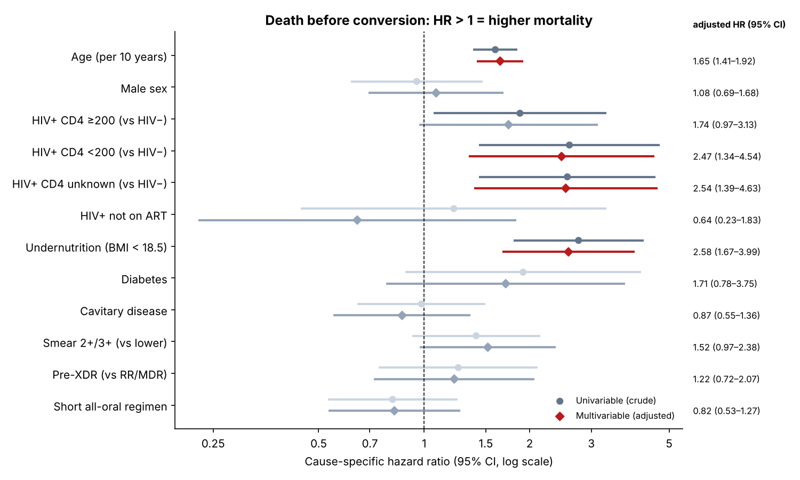
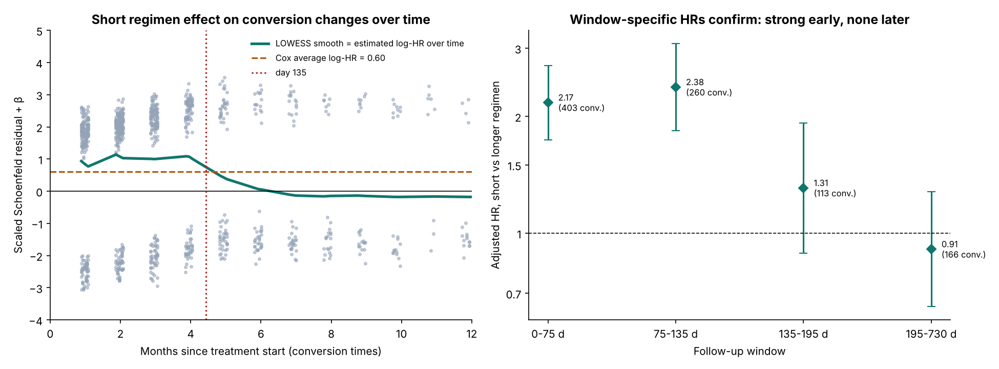

# MDR/RR-TB Survival & Competing-Risks Analysis: who converts, who dies, who is lost, and when?

A biostatistics project on a **simulated cohort of 1,200 adults treated for multidrug/rifampicin-resistant TB in six western Kenya counties** (Kisumu, Siaya, Homa Bay, Migori, Kakamega, Busia), enrolled 2023–2025 and followed for up to 24 months.

* **Primary outcome:** time to sputum **culture conversion**, with **death** and **loss to follow-up (LTFU)** before conversion as **competing events**.
* **Secondary outcome:** **overall survival** (all-cause death) with administrative censoring.

Built in **Python** (lifelines) and rebuilt independently in **R** (`survival`). The two pipelines agree on every hazard ratio (max relative difference 8 × 10⁻⁹), every Aalen–Johansen cumulative incidence (difference 0), every Kaplan–Meier estimate and log-rank statistic (≤ 10⁻¹³) and the C-index.

> ⚠️ **SIMULATED DATA — NOT REAL PATIENTS.** Every record is generated by [`data/generate_data.py`](data/generate_data.py) from a random-number generator with *assumed, illustrative* effect sizes. The data **do not** reproduce, approximate or derive from any real study's data or findings, and **no real patient data are used**. Numbers below describe the simulation and must not be quoted as evidence about TB in Kenya.

| | |
|---|---|
| 📓 **Full walkthrough, every step explained** (clinical + data audience) | [`python/mdr_tb_survival_analysis.ipynb`](python/mdr_tb_survival_analysis.ipynb) |
| 📊 **R rebuild + cross-check report** | [`R/mdr_tb_survival.R`](R/mdr_tb_survival.R) → [`outputs/r/R_results.md`](outputs/r/R_results.md) |
| 📋 **Result tables** (Table 1, CIFs, HRs, PH tests, performance) | [`outputs/python/`](outputs/python) |

---

## 1. Why this analysis?

My published work looked at **who develops drug resistance** among presumptive MDR-TB patients in western Kenya:

> Okumu A, et al. Factors associated with tuberculosis drug resistance among presumptive MDR-TB patients identified in a DR-TB surveillance study in western Kenya. *J Clin Tuberc Other Mycobact Dis.* 2024;37:100466.

The natural next question for a TB programme is **what happens once those patients start treatment**. That question motivates this project, but it does **not** use or reproduce the study's data or results. Three outcomes compete:

| Outcome | Why it matters |
|---|---|
| **Culture conversion** | Earliest marker that treatment works and the patient is no longer infectious |
| **Death** | MDR-TB mortality is high, especially with advanced HIV and undernutrition |
| **Loss to follow-up** | Drives transmission and amplifies resistance |

They are **time-to-event** outcomes with **censoring** (staggered enrolment, fixed data cut-off) and **competing risks** (a patient who dies can never convert). Proportions and logistic regression get this wrong; survival methods don't.

## 2. Research questions

1. What proportion of patients convert by 2, 6, 12 and 24 months, accounting for death and LTFU before conversion?
2. Which baseline factors are associated with the rate of conversion, of death before conversion and of LTFU before conversion?
3. What is overall survival at 6, 12 and 24 months, and how does it vary by HIV/CD4, nutrition, resistance and regimen?
4. How wrong is the naive 1 − Kaplan–Meier "probability of conversion"?

## 3. Methods

```
register export (dates) ──► cleaning log: 4 duplicates removed, 3 impossible BMIs set to missing, 6 date-logic checks
   └─► derive times: primary = first of {conversion, death, LTFU} | OS = all-cause death, censored at LTFU/transfer/cut-off
        ├─► Missing data: CD4 (29% of HIV+, MAR on distance) → missing-indicator category; BMI (4%) → complete case
        ├─► Table 1 by HIV status (Mann–Whitney, χ² / Fisher) · reverse-KM median follow-up
        ├─► Overall survival: Kaplan–Meier (Greenwood, log-log CI) · log-rank tests
        ├─► Cumulative incidence: Aalen–Johansen (exact, tie-aware implementation) vs naive 1 − KM
        ├─► Cause-specific Cox models (Efron ties): conversion · death · LTFU; univariable + multivariable; forest plots
        ├─► PH checks: scaled Schoenfeld residuals (lifelines) + cox.zph (R) → time-split remedy at day 135
        ├─► Concordance (apparent + 5-fold CV) · OS Cox model · complete-case sensitivity analysis
        └─► Simulation check: do 95% CIs cover the true data-generating hazard ratios?
```

**Why cause-specific hazards?** The questions are aetiological ("does cavitation slow conversion?"), so the cause-specific HR (the event rate among those still at risk) is the right estimand. Absolute risks are reported non-parametrically as CIFs. A Fine–Gray subdistribution model answers a prognostic question instead. It is not available in lifelines 0.30.3, and the notebook explains when you would use it.

## 4. Results

**Cohort:** 1,200 patients · 34.4% HIV-positive · 33.2% undernourished (BMI < 18.5) · 13.9% pre-XDR · 58.0% on the short all-oral regimen · median potential follow-up 18.1 months (reverse KM) · 1,486 person-years.

| Primary outcome (first event) | n | % |
|---|---:|---:|
| Culture conversion | 987 | 82.2 |
| Death before conversion | 91 | 7.6 |
| LTFU before conversion | 95 | 7.9 |
| Censored (cut-off / transfer / culture-positive at 24 m) | 27 | 2.2 |

156 deaths in total over 24 months, **65 of them after conversion**.



### 4.1 Overall survival (Kaplan–Meier)

| | Survival | 95% CI |
|---|---:|---|
| 6 months | **91.8%** | 90.1–93.3 |
| 12 months | **88.0%** | 85.9–89.9 |
| 24 months | **83.7%** | 81.1–86.0 |

Median survival is **not reached**. 39% of deaths happen in the first 3 months. 24-month survival is 87.4% for HIV-negative patients vs 74.3% with CD4 < 200 (log-rank p < 0.001), and 88.9% vs 72.3% by nutritional status (p < 0.001).




### 4.2 Cumulative incidence (Aalen–Johansen) and the 1 − KM bias

| | 2 months | 6 months | 12 months | 24 months |
|---|---:|---:|---:|---:|
| **Culture conversion** (CIF) | 29.5% | **67.5%** (64.3–69.6) | **80.8%** (78.4–82.9) | **83.9%** (81.7–85.9) |
| Death before conversion | 3.8% | 6.3% | 7.5% | **7.7%** |
| LTFU before conversion | 3.3% | 6.4% | 7.9% | **8.0%** |
| *Naive 1 − KM for conversion* | *31.1%* | *75.2%* | *94.1%* | ***99.2%*** |

**Ignoring competing risks overstates conversion by 15 percentage points at 24 months** (99.2% vs 83.9%), and overstates death and LTFU about threefold (22.7% vs 7.7%; 24.5% vs 8.0%). Median time to conversion is **118 days** from the CIF (93 days naively). *CIs from lifelines' delta-method variance; R's estimator gives intervals within 0.013.*





### 4.3 Cause-specific Cox models (adjusted HRs, 95% CI)

| Factor | Conversion (HR < 1 = slower) | Death before conversion | LTFU before conversion |
|---|---|---|---|
| Smear 2+/3+ (vs neg/scanty) | **0.54** (0.46–0.64) | 1.52 (0.97–2.38)ᵃ | — |
| Cavitary disease | **0.75** (0.65–0.86) | 0.87 (0.55–1.36) | — |
| Undernutrition (BMI < 18.5) | **0.70** (0.61–0.81) | **2.58** (1.67–3.99) | — |
| HIV+ CD4 < 200 (vs HIV−) | **0.77** (0.61–0.98) | **2.47** (1.34–4.54) | 0.96 (any HIV)ᵇ |
| HIV+ CD4 unknown (vs HIV−) | 0.97 (0.77–1.22) | **2.54** (1.39–4.63) | |
| Diabetes | **0.65** (0.45–0.93) | 1.71 (0.78–3.75) | — |
| Pre-XDR (vs RR/MDR) | **0.77** (0.63–0.93) | 1.22 (0.72–2.07) | — |
| Previous TB treatment | **0.83** (0.73–0.95) | — | 0.75 (0.50–1.15) |
| Age (per 10 years) | 0.97 (0.92–1.03) | **1.65** (1.41–1.92) | — |
| Adherence (per 10% below 90%) | **0.87** (0.81–0.94) | — | **1.40** (1.15–1.70) |
| Current smoker | 0.87 (0.73–1.03) | — | **1.85** (1.18–2.92) |
| Distance (per 10 km) | 1.00 (0.93–1.06) | — | 1.11 (0.96–1.28) |
| Short all-oral regimen | 1.82 (1.59–2.08) → **time-varying, see 4.4** | 0.82 (0.53–1.27) | 0.74 → **1.00 within months 0–6** |

ᵃ smear 2+/3+ vs lower grades · ᵇ HIV-positive vs negative · — = not in that pre-specified model. Events: 942 / 88 / 92 (regression set n = 1,148 with known BMI). Full tables: [`cox_cause_specific_hazard_ratios.csv`](outputs/python/cox_cause_specific_hazard_ratios.csv).




### 4.4 Proportional-hazards checks: one real violation, one structural, one false alarm

| Model · covariate | lifelines Schoenfeld p | R `cox.zph` p | Verdict |
|---|---:|---:|---|
| Conversion · short regimen | 0.0007 | < 0.001 | **Real:** effect strong early, gone later → time-split at day 135 |
| LTFU · short regimen | 0.018 | 0.009 | **Structural:** short-regimen patients can't be lost after treatment ends at 6 months. Restricted to months 0–6: HR **1.00** (0.63–1.60), PH p = 0.87 |
| Death · diabetes | 0.036 | 0.009 | **Likely false positive:** only 7 events; stratifying on diabetes moves other HRs ≤ 7.3%; true simulated effect is constant |

**Remedy (episode splitting at day 135, midway between month-4 and month-5 cultures):** short regimen HR **2.27 (1.92–2.68) in days 0–135** vs **1.13 (0.89–1.45) after**. Wald test of equality p = 4.4 × 10⁻⁶; LR χ² = 21.7; no remaining violation (`cox.zph` global p = 0.75).



### 4.5 Overall-survival model, performance, sensitivity

* **All-cause mortality** (151 deaths): age 1.47/10 y, CD4 < 200 **2.45**, CD4 unknown 2.13, undernutrition **2.62**, smear 2+/3+ 1.75. The short regimen is associated with lower all-cause mortality (0.72, 0.52–1.00, p = 0.047) but not with death *before* conversion. That pattern is consistent with a benefit that works through faster conversion; the design is observational, so it is a hypothesis.
* **Discrimination (Harrell's C, apparent / 5-fold CV):** conversion 0.652 / 0.640 · death before conversion 0.758 / 0.723 · LTFU 0.687 / 0.650 · overall survival 0.727 / 0.710.
* **Complete-case sensitivity** (excluding 115 HIV+ with unknown CD4): conversion HRs change ≤ 4%; main death predictors < 4%. Only imprecise small-group estimates move more, and they stay within their original CIs.
* **Simulation truth check:** **32 of 34** 95% CIs cover the true data-generating HR (≈ 32 expected). A cautionary case: "HIV+ not on ART" (n = 46) estimates 0.64 against a true 1.7. Its very wide CI (0.23–1.83) covers the truth, but the point estimate alone would mislead.

## 5. Clinical & public-health interpretation

| Finding (simulated) | Recommendation |
|---|---|
| Undernutrition: death HR ≈ 2.6, slower conversion; affects 1 in 3 | **Nutritional assessment and support from day 1** for everyone with BMI < 18.5 |
| Advanced HIV *and* unknown CD4: death HR ≈ 2.5 | CD4 at treatment start; treat "CD4 unknown" as high risk; fast-track ART and advanced-HIV-disease package |
| 39% of deaths in the first 3 months | Intensified (weekly) review in months 0–3 for older, HIV-positive and undernourished patients |
| Low early DOT adherence → LTFU (HR 1.40) and slower conversion | Use 2-week adherence as an **early-warning trigger** for counselling, VOT/community DOT, transport enablers |
| Short all-oral regimen doubles early conversion | Keep scaling up eligible patients; review why others stay on long regimens |
| Still culture-positive at month 4–5 | Structured review: repeat DST, adherence, comorbidities |
| Naive 1 − KM says 99% convert; truth is 84% | **Report programme outcomes as CIFs with competing events** |

## 6. Where these methods are used in biostatistics

| Field | Time-to-event question | Competing events |
|---|---|---|
| TB & HIV programmes | Culture conversion, ART initiation, viral suppression | Death, LTFU, transfer |
| Oncology | Overall / progression-free survival, relapse | Death from other causes |
| Cardiovascular epidemiology | First MI or stroke | Non-CV death |
| Clinical trials | Primary endpoint with administrative censoring | Death before non-fatal endpoint |
| Maternal & child health | Under-5 survival, weaning, birth intervals | Death, migration |
| Transplantation | Time to transplant on waiting list | Death or delisting |
| Health services | Readmission after discharge | Death after discharge |

## 7. Limitations

* **Simulated data:** illustrative effects only; nothing here is evidence about real patients.
* **Observational:** regimen allocation was not randomised; HRs are associations.
* **Interval-censored conversion:** detected only at monthly cultures (heavy ties, handled with Efron's method).
* **Informative censoring:** LTFU patients are censored in the OS analysis but may die unobserved.
* **Adherence measured in the first 2 weeks** is post-baseline (16 deaths and 9 LTFU events happen before day 14); a landmark analysis would be cleaner.
* **Missing data:** missing-indicator for CD4 (checked by a complete-case analysis); multiple imputation would be the principled next step.
* **Small subgroups and 7.3 events per parameter** in the death model; time-split cut-point chosen after inspecting residuals; no external validation; no Fine–Gray or Gray's test.

## 8. Ethics & data note

No real patient data were accessed or used. The simulation is not derived from, and does not reproduce, the data or findings of Okumu et al. 2024 or any other study. A real analysis would need approval from an accredited Kenyan ethics committee, a NACOSTI licence, NTLD-P and county permission, and data handling under the Kenya Data Protection Act (2019), with no record-level data published.

## 9. Run it

```bash
pip install -r requirements.txt
python data/generate_data.py                                       # optional: regenerate the simulated cohort (seeded)
python python/build_notebook.py
jupyter nbconvert --to notebook --execute --inplace python/mdr_tb_survival_analysis.ipynb
Rscript R/mdr_tb_survival.R                                        # base R + survival; run after the notebook for the cross-check
```

```
mdr-tb-survival-analysis/
├── data/      generate_data.py · mdr_tb_cohort_simulated.csv (1,204 rows incl. 4 planted duplicates)
├── python/    build_notebook.py · mdr_tb_survival_analysis.ipynb (executed, outputs embedded)
├── R/         mdr_tb_survival.R (independent rebuild + cross-check)
└── outputs/   python/ (10 charts, 12 CSV tables) · r/ (4 charts, R_results.md, CSVs)
```

**Stack:** Python · lifelines · pandas · NumPy · SciPy · statsmodels · matplotlib · nbformat · R (survival, base graphics)
