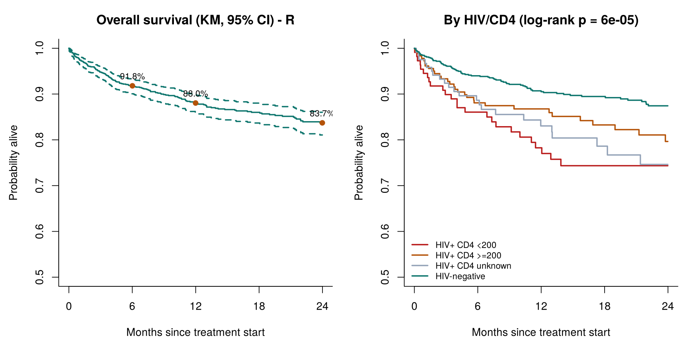
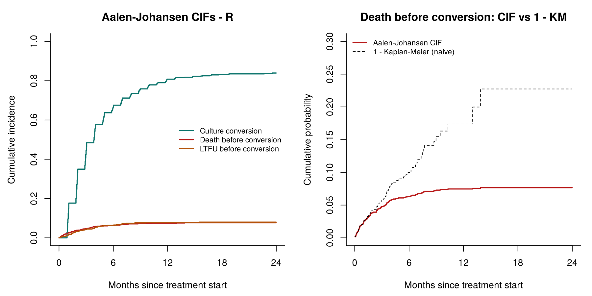
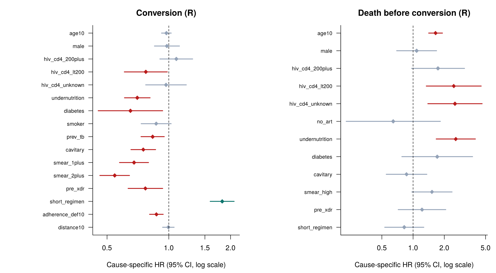
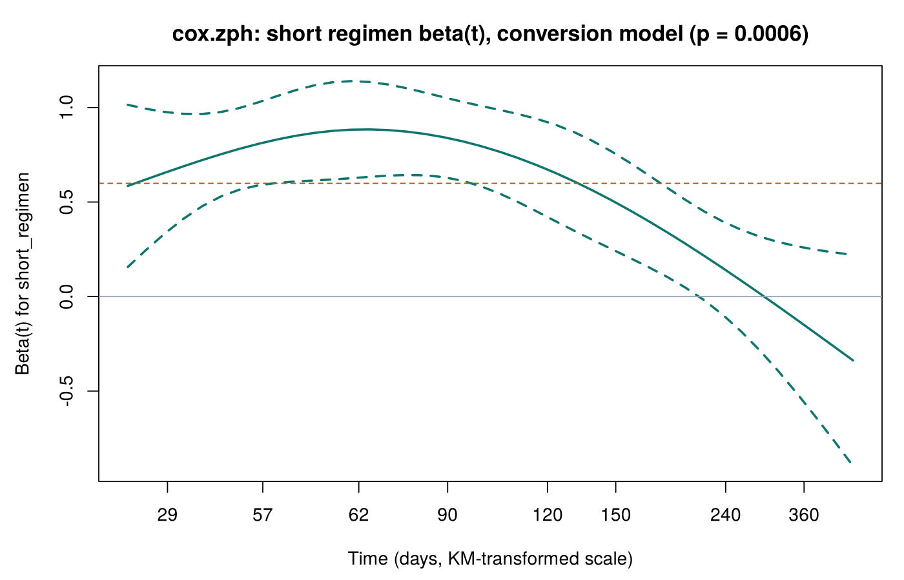

# MDR/RR-TB survival analysis - R results (auto-generated by `R/mdr_tb_survival.R`)

> **SIMULATED DATA.** Generated by `data/generate_data.py`; does not reproduce any real study's data or findings.

*1200 patients (1148 in the regression set with known BMI) · conversion 987 · death before conversion 91 · LTFU before conversion 95 · censored 27 · all-cause deaths 156*

## Cross-check with the Python notebook

- Cause-specific Cox HRs (3 models, 36 terms): max relative difference 8.0e-09; max |difference| in 95% CI limits 2.0e-08
- Time-split conversion model (17 terms, counting-process data): max relative HR difference 1.8e-10
- Overall-survival Cox model (12 terms): max relative HR difference 7.6e-11
- Aalen-Johansen CIFs (12 cause x time points): max |R - Python exact| = 0.0e+00; max |R - lifelines (jittered)| = 1.2e-02; naive 1-KM max |diff| = 4.0e-15
- CIF 95% CI limits: max |R - lifelines| = 0.013 (different variance estimators: R infinitesimal jackknife vs lifelines delta method - expected to differ slightly)
- Kaplan-Meier overall survival at 6/12/24 months: max |difference| 1.0e-15 (estimates), 1.0e-15 (log-log CI limits)
- Log-rank chi-square (4 comparisons): max |difference| 9.2e-14
- Harrell's C (4 models): max |difference| 1.1e-16

Point estimates from `coxph` (Efron ties) and lifelines agree to optimiser precision. The exact Aalen-Johansen estimator in the notebook agrees with R's multi-state `survfit` to floating-point precision; lifelines' own `AalenJohansenFitter` differs slightly because it breaks tied times with random jitter.

## Overall survival (Kaplan-Meier, log-log 95% CI)

| time | survival | 95% CI |
| --- | --- | --- |
| 6 months | 0.918 | 0.901 - 0.933 |
| 12 months | 0.880 | 0.859 - 0.899 |
| 24 months | 0.837 | 0.811 - 0.860 |

Median overall survival: not reached.

| comparison | chi2 | df | p |
| --- | --- | --- | --- |
| HIV / CD4 status | 22.29 | 3 | <0.001 |
| Nutritional status | 40.02 | 1 | <0.001 |
| Resistance pattern | 1.05 | 1 | 0.306 |
| Regimen | 3.45 | 1 | 0.063 |

## Cumulative incidence (Aalen-Johansen) vs naive 1 - KM

| event | time | CIF | 95% CI | naive 1-KM |
| --- | --- | --- | --- | --- |
| Culture conversion | 2 months | 0.295 | 0.270 - 0.322 | 0.311 |
| Culture conversion | 6 months | 0.675 | 0.649 - 0.702 | 0.752 |
| Culture conversion | 12 months | 0.808 | 0.785 - 0.831 | 0.941 |
| Culture conversion | 24 months | 0.839 | 0.818 - 0.860 | 0.992 |
| Death before conversion | 2 months | 0.038 | 0.029 - 0.051 | 0.042 |
| Death before conversion | 6 months | 0.063 | 0.051 - 0.079 | 0.100 |
| Death before conversion | 12 months | 0.075 | 0.061 - 0.091 | 0.174 |
| Death before conversion | 24 months | 0.077 | 0.063 - 0.093 | 0.227 |
| LTFU before conversion | 2 months | 0.033 | 0.024 - 0.044 | 0.038 |
| LTFU before conversion | 6 months | 0.064 | 0.052 - 0.080 | 0.115 |
| LTFU before conversion | 12 months | 0.079 | 0.065 - 0.096 | 0.205 |
| LTFU before conversion | 24 months | 0.080 | 0.066 - 0.097 | 0.245 |

## Cause-specific Cox models (multivariable)

### Culture conversion (events = 942, C = 0.652)

| term | HR | 95% CI | p |
| --- | --- | --- | --- |
| age10 | 0.97 | 0.92 - 1.03 | 0.328 |
| male | 0.98 | 0.85 - 1.13 | 0.773 |
| hiv_cd4_200plus | 1.09 | 0.90 - 1.31 | 0.372 |
| hiv_cd4_lt200 | 0.77 | 0.61 - 0.98 | 0.036 |
| hiv_cd4_unknown | 0.97 | 0.77 - 1.22 | 0.786 |
| undernutrition | 0.70 | 0.61 - 0.81 | <0.001 |
| diabetes | 0.65 | 0.45 - 0.93 | 0.020 |
| smoker | 0.87 | 0.73 - 1.03 | 0.098 |
| prev_tb | 0.83 | 0.73 - 0.95 | 0.006 |
| cavitary | 0.75 | 0.65 - 0.86 | <0.001 |
| smear_1plus | 0.68 | 0.58 - 0.80 | <0.001 |
| smear_2plus | 0.54 | 0.46 - 0.64 | <0.001 |
| pre_xdr | 0.77 | 0.63 - 0.93 | 0.008 |
| short_regimen | 1.82 | 1.59 - 2.08 | <0.001 |
| adherence_def10 | 0.87 | 0.81 - 0.94 | <0.001 |
| distance10 | 1.00 | 0.93 - 1.06 | 0.887 |

### Death before conversion (events = 88, C = 0.758)

| term | HR | 95% CI | p |
| --- | --- | --- | --- |
| age10 | 1.65 | 1.41 - 1.92 | <0.001 |
| male | 1.08 | 0.69 - 1.68 | 0.728 |
| hiv_cd4_200plus | 1.74 | 0.97 - 3.13 | 0.065 |
| hiv_cd4_lt200 | 2.47 | 1.34 - 4.54 | 0.004 |
| hiv_cd4_unknown | 2.54 | 1.39 - 4.63 | 0.002 |
| no_art | 0.64 | 0.23 - 1.83 | 0.410 |
| undernutrition | 2.58 | 1.67 - 3.99 | <0.001 |
| diabetes | 1.71 | 0.78 - 3.75 | 0.181 |
| cavitary | 0.87 | 0.55 - 1.36 | 0.528 |
| smear_high | 1.52 | 0.97 - 2.38 | 0.067 |
| pre_xdr | 1.22 | 0.72 - 2.07 | 0.463 |
| short_regimen | 0.82 | 0.53 - 1.27 | 0.377 |

### LTFU before conversion (events = 92, C = 0.687)

| term | HR | 95% CI | p |
| --- | --- | --- | --- |
| age_under25 | 1.58 | 0.92 - 2.73 | 0.098 |
| male | 1.61 | 0.93 - 2.77 | 0.086 |
| hiv_pos | 0.96 | 0.60 - 1.51 | 0.845 |
| smoker | 1.85 | 1.18 - 2.92 | 0.008 |
| prev_tb | 0.75 | 0.50 - 1.15 | 0.187 |
| short_regimen | 0.74 | 0.48 - 1.14 | 0.170 |
| adherence_def10 | 1.40 | 1.15 - 1.70 | <0.001 |
| distance10 | 1.11 | 0.96 - 1.28 | 0.154 |

## Proportional hazards (cox.zph, KM transform)

- Global test p-values: conversion 0.138, death 0.379, LTFU 0.074
- Covariates with p < 0.05:

| model | term | chisq | p |
| --- | --- | --- | --- |
| Culture conversion | short_regimen | 11.84 | <0.001 |
| Death before conversion | diabetes | 6.75 | 0.009 |
| LTFU before conversion | short_regimen | 6.73 | 0.009 |

### Remedy: regimen effect split at day 135 (survSplit, counting-process Cox)

| term | HR | 95% CI | p |
| --- | --- | --- | --- |
| short_0_135 | 2.27 | 1.92 - 2.68 | <0.001 |
| short_after135 | 1.13 | 0.89 - 1.45 | 0.311 |

cox.zph on the time-split model: global p = 0.750; smallest covariate p = 0.147 (diabetes).

## Overall-survival Cox model (deaths = 151, C = 0.727)

| term | HR | 95% CI | p |
| --- | --- | --- | --- |
| age10 | 1.47 | 1.31 - 1.66 | <0.001 |
| male | 1.16 | 0.83 - 1.63 | 0.383 |
| hiv_cd4_200plus | 1.59 | 1.02 - 2.47 | 0.042 |
| hiv_cd4_lt200 | 2.45 | 1.52 - 3.94 | <0.001 |
| hiv_cd4_unknown | 2.13 | 1.32 - 3.44 | 0.002 |
| no_art | 0.95 | 0.45 - 2.01 | 0.888 |
| undernutrition | 2.62 | 1.89 - 3.62 | <0.001 |
| diabetes | 1.89 | 0.98 - 3.62 | 0.056 |
| cavitary | 1.11 | 0.79 - 1.57 | 0.548 |
| smear_high | 1.75 | 1.25 - 2.46 | 0.001 |
| pre_xdr | 1.07 | 0.69 - 1.67 | 0.754 |
| short_regimen | 0.72 | 0.52 - 1.00 | 0.047 |
